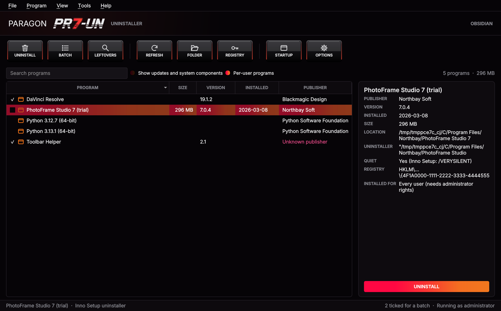
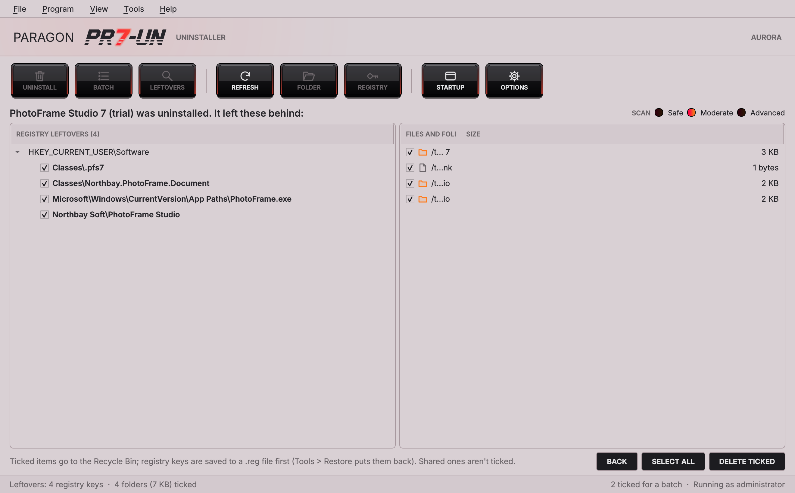
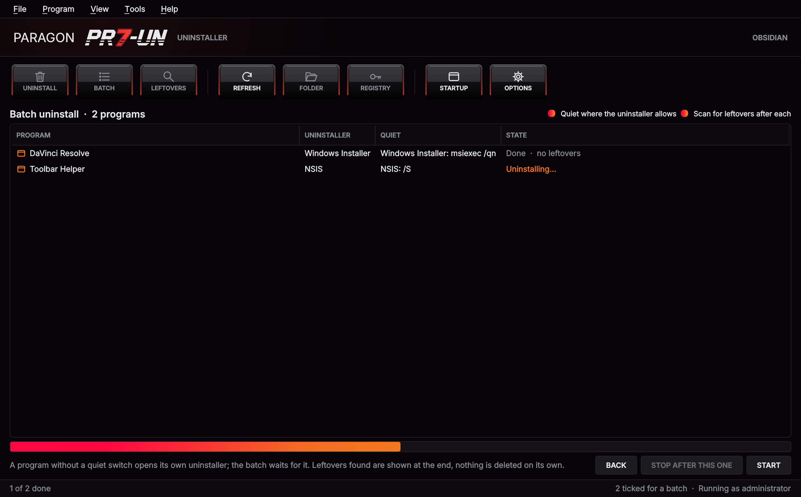

# Paragon PR7-UN

Uninstalls programs and what they leave behind, the way **Revo Uninstaller** works (with Bulk Crap Uninstaller's
batch), in the Paragon family look (PR7-Z ... PR7-WM, PR7-HX, PR7-DB). Python and PySide6.

## What it does

- **Installed programs:** the list Windows keeps (machine 64-bit, 32-bit and per-user), with size, version, install
  date and publisher. Updates and system components are hidden unless you ask. A search box, and a details panel:
  install folder, uninstaller, whether it can uninstall quietly, its registry entry, who it's installed for.
- **Uninstall:** a program's own uninstaller runs. PR7-UN waits until it's really finished, including uninstallers
  that hand over to a copy of themselves, then checks the program is gone.
- **Leftovers:** what it left behind, in three modes (Safe, Moderate, Advanced): registry keys, folders, Start menu
  entries, file types, App Paths.
  - Shared things are found but never ticked: a publisher's folder holding other products, or a name another
    installed program also uses (uninstalling Python 3.12 won't offer 3.13's folder).
  - Windows, Program Files and your profile folders are never offered.
  - Deleting sends folders to the Recycle Bin and saves registry keys to a .reg backup first. Tools > Restore puts
    them back.
- **Batch:** tick several programs. Each uninstalls quietly where its uninstaller allows (Inno Setup, NSIS, Windows
  Installer, or its own quiet command), one after another, with Stop after this one. Leftovers are collected and
  shown at the end; nothing is deleted on its own.
- **Also:** open the install folder (in PR7-E when installed), its entry in Regedit, a web search, Startup programs
  in PR7-AR, and Restart as Administrator for programs installed for every user.

## Building

`pip install -r requirements.txt -r requirements-dev.txt`, `python -m pytest`, `pyinstaller pr7un.spec`, then Inno Setup:
`iscc /DAppVersion=x.y.z installer\pr7un.iss`.
